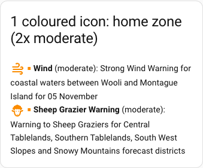
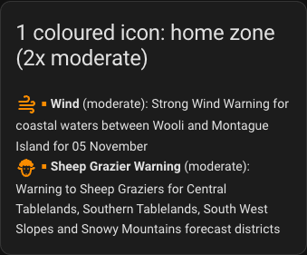
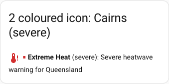
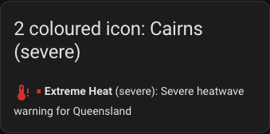

# ha-bom-warnings

Bureau of Meteorology warnings as Home Assistant entities and events (domain `bom_warnings`).

*Unofficial and for personal use. The warning data belongs to the Bureau of Meteorology: see
[Licence](#licence).*

## Contents

- [Key features](#key-features): what it does, with screenshots ([On your dashboard](#on-your-dashboard))
- [Requirements](#requirements): Home Assistant version, disk space and what it asks the Bureau for
- [Install](#install): HACS or manual, and adding the integration
- [Locations](#locations): home, typed coordinates or a zone ([Coastal waters](#coastal-waters))
- [Dashboard](#dashboard): the card, or built-in cards
- [Entities](#entities): the sensors and the event entity
  - [Which areas a location covers](#which-areas-a-location-covers)
  - [Summary and attribution](#summary-and-attribution)
  - [Warnings that have not started yet](#warnings-that-have-not-started-yet)
  - [Choosing the warnings that matter](#choosing-the-warnings-that-matter)
  - [Per-warning-type level sensors](#per-warning-type-level-sensors)
- [Development](#development)
- [Licence](#licence)

## Key features

- **Official warnings, for the places you care about.** Severe thunderstorm, fire weather, flood,
  heatwave, frost, tropical cyclone, marine wind, hazardous surf and the other Bureau of Meteorology
  warning types arrive as Home Assistant entities, checked every 10 minutes.
  The data comes straight from the Bureau's own warning feed, with no account or API key.
- **Warnings for the right area.** A warning is matched against the Bureau's own area boundaries
  (forecast districts, metro areas, flood catchments, fire weather districts and coastal waters), so
  you hear about warnings that cover you, not every warning in the state.
- **One location per place.** Add your Home Assistant home, a typed latitude and longitude, or any
  Home Assistant zone: Home, Work, a holiday house, your parents' place. A zone's circle can cover
  several districts, up to a 50 km radius, and the entry follows the zone if you move or resize it.
  Each location gets its own entities.
- **Sensors you can build on.**
  - A *warning* binary sensor that is on while any current warning covers the location.
  - A *warning count* and a *most severe warning* sensor, with the headline, expiry and a one-line
    summary as attributes.
  - One sensor per warning type (thunderstorm, flood, fire weather and so on) whose state is the
    level: `none`, `minor`, `moderate`, `severe` or `extreme`. This is the one to use in
    automations, for example to close the blinds when a thunderstorm warning goes severe.
  - An *event* entity that fires when a warning appears or changes, for notifications.
  - Today's and tomorrow's fire danger rating, for locations in a fire weather district.
- **Pick the warnings that matter.** Tick the types you want in the entry's options. The rest are
  ignored everywhere and their sensors are removed. You can also hide final and cancelled warnings.
- **It says which area a warning is for.** Each warning lists the names of the districts it covers
  (for example `Illawarra`), so a warning for the next district over looks different from one for
  yours.
- **Made for dashboards.** The companion [BoM Warnings Card](https://github.com/rhgof/ha-bom-warnings-card)
  shows the warnings, most severe first, with icons in the colour of each severity. No YAML is needed.

### On your dashboard

The warnings can be listed most severe first, with an icon in the colour of each warning's level.
These are two moderate warnings and one severe warning, in a light and a dark theme:

| Light | Dark |
| --- | --- |
|  |  |
|  |  |

Those were made with Home Assistant's own Markdown card, using the ready-made section in
[docs/dashboard.md](docs/dashboard.md). The companion
[BoM Warnings Card](https://github.com/rhgof/ha-bom-warnings-card), installed through HACS, draws the
same list without any template, and adds a tile for a single warning type.

## Requirements

- **Home Assistant 2026.10.4.** This is the only version it has been tested on. An older or newer
  one may work, but nobody has tried. Nothing else needs installing: the one Python library it uses
  (`pyshp`) is fetched by Home Assistant itself, and it uses Home Assistant's built-in Zones.
- **Outbound access to the Bureau's FTP server**, `ftp.bom.gov.au` on port 21 (passive mode, so
  your firewall must also allow the data connection FTP opens). No account, key or inbound port is
  needed. A network that blocks FTP, or a proxy that cannot pass it, will stop it working.
- **About 60 MB of disk space** in your Home Assistant configuration folder, under
  `bom_warnings/spatial`. It holds the Bureau's area boundary files, which are used to work out
  which warnings cover your location. Allow about 50 MB more free while a boundary file is being
  replaced, which happens only when the Bureau changes one. The warnings themselves are held in
  memory, and fire danger ratings take a few kilobytes of Home Assistant storage per location.
- **A one-off download of about 28 MB** the first time you add a location, for those boundary
  files. Allow a minute. It is not repeated unless the Bureau updates a file.

### What it asks the Bureau for

Every 10 minutes the integration makes one FTP connection and checks for changes. The interval is
fixed and cannot be changed, so it cannot be set to hammer the Bureau's server. The checks are
shared by every location you add: five locations cost the same as one, except for fire danger,
which is one file for each state your locations are in.

| When | Requests | Size |
| --- | --- | --- |
| Every poll (every 10 minutes) | One listing of the current warning files | About 1 KB |
| Each new or changed warning | One fetch of that warning's file | 2 to 6 KB each (median 3 KB) |
| A flood or marine wind warning, once per new issue | One listing and one fetch of its detail file, for the description and strength | 5 to 26 KB (a file over 400 KB is skipped) |
| Every poll, for each state with a fire danger location | One listing of that state's fire danger file, and a fetch only if it changed | 19 to 77 KB when fetched |
| The first poll after a restart | Every current warning file | About 90 KB when 26 warnings are current |
| Weekly | A modified-time check of each of the six boundary files, and a download only of one that changed | 2 to 13 MB, only if changed |

A quiet day is about 144 polls of roughly 1 KB each, well under 1 MB in total. A day with many
warnings is still a few hundred kilobytes, because only new or changed files are fetched. The
Bureau's server starts timing out after about a hundred requests in a few minutes, and this stays
far below that.

## Install

**HACS:** add this repository in HACS as a custom repository of type Integration, download
BoM Warnings, and restart Home Assistant. This route has not been tried yet, so use the manual
install if it fails.

**Manual:** copy the `custom_components/bom_warnings` folder from this repository into the
`custom_components` folder of your Home Assistant configuration directory, using whatever
file access your install offers, then restart Home Assistant.

Then go to Settings > Devices & services > Add integration > **BoM Warnings**. The first location
you add downloads the Bureau's area boundary files, so allow a minute. Take a full backup first.

## Locations

Add a location from Settings > Devices & services. There are three kinds:

- **Home Assistant home location**, or **typed latitude/longitude**: warnings for the areas the
  point is inside.
- **A Home Assistant zone** (Settings > Areas, labels & zones > Zones; Home, Work, a holiday
  house): warnings for every forecast district, metro area, flood catchment and fire weather
  district that the zone's circle touches. The entry follows the zone, so moving or resizing it
  needs no delete and re-add. The radius is used up to 50 km; a larger one is clamped and a repair
  notice says so. Deleting the zone leaves the entry on its last areas and raises a repair notice.

Each zone is its own entry, so Home, Work and a holiday house each get their own entities.

### Coastal waters

Marine wind and hazardous surf warnings apply to coastal water zones, which a point on land is
never inside. A zone whose circle reaches the sea (a few kilometres out from the coast is enough
for a Sydney zone; a harbour is closer) counts those warnings like any other, provided Marine wind
and Hazardous surf are on in the entry's warning types (they are by default). A Home or typed
point only sees them if it sits on the water. Tsunami and tropical cyclone place warnings are not
matched yet.

## Dashboard

Two ways to show the warnings on a dashboard, both described in [docs/dashboard.md](docs/dashboard.md):

- **A card:** [ha-bom-warnings-card](https://github.com/rhgof/ha-bom-warnings-card) is a Lovelace
  card installed through HACS. It lists the warnings, most severe first, with a coloured icon per
  severity, and is added and configured from the dashboard editor with no YAML.
- **Built-in cards:** a ready-made section made from Home Assistant's own Markdown, tile and
  conditional cards, for when you would rather not install a card.

## Entities

Each location gets a warning binary sensor (on while any current warning covers it), a warning
count, a most severe warning sensor and an event entity that fires when a warning appears or
changes. Locations in a fire weather district (every state, and the ACT through NSW) also get today's and
tomorrow's fire danger rating.

### Which areas a location covers

The warning count sensor has an `areas` attribute: the names of the forecast districts, metro
areas, flood catchments, fire weather districts and coastal waters the location covers, as BoM
names them (a forecast district such as `Illawarra`). It shows even when no warning is active, so editing a zone's
radius is visible straight away: grow it over a second district and that district's name appears;
shrink it and the name goes. Each item in a `warnings` list also has an `area`, the names of the
location's areas that warning covers, so a warning for a neighbouring district looks different from
one for yours. `area` is left out when none of those areas has a name. Names come from BoM's
shapefiles, never area codes.

### Summary and attribution

Each item in a `warnings` list also has a `summary`: the first paragraph of the warning's text from
BoM, on one line and cut to 300 characters with an ellipsis if it was longer. For a marine wind
warning it is the one-line description of the warning, for example "Strong Wind Warning for Coffs
Coast, Macquarie Coast, Hunter Coast, Sydney Coast, Illawarra Coast and Batemans Coast". `summary`
is left out when BoM sends no text; the warning itself is unaffected. Check for it with
`` or `w.summary | default('')` in a template. The Most severe warning sensor and
each per-warning-type sensor also show their top warning's `summary` as an attribute, so a tile can
show it with `state_content: summary`; the warning count sensor and the warning binary sensor show it
only inside the list.

Every warning entity carries the attribution "Australian Government Bureau of Meteorology" as its
`attribution` attribute, as the fire danger sensors do. Home Assistant shows it in the entity's
details; a tile does not. The text is the Bureau's, under its own terms
(<http://www.bom.gov.au/other/copyright.shtml>).

### Warnings that have not started yet

A warning counts from the moment the Bureau issues it, even when it says it starts later. Marine
wind warnings, for example, are often sent a day ahead. That gives you advance notice: the warning
sensor turns on and the level sensors rise when the warning is issued, not when it begins.

To tell an upcoming warning from one already in force, each warning in a `warnings` list has
`in_force` (`false` until its start time, `true` after) and an `effective` start time. The Most
severe warning sensor and each per-warning-type sensor show `in_force` for their top warning too.
Because Home Assistant reads the Bureau every 10 minutes, `in_force` can be up to 10 minutes late
changing to `true`. To act only on warnings already in force:

```yaml
conditions:
  - condition: template
    value_template: "{{ state_attr('sensor.home_thunderstorm_warning', 'in_force') }}"
```

### Choosing the warnings that matter

Open the entry's **Configure** (three-dot menu). The form is a checklist, "Warnings I care about":
one list of warning types with a tick box each, plus a switch for hiding final and cancelled
warnings.

- **Ticked** (the default for every type): the type counts everywhere (the warning sensor, the count,
  the most severe warning, the warning list and the events) and has its own sensor, already
  enabled.
- **Unticked**: the type is ignored everywhere and its sensor is removed from the entity list. Tick it
  again and the sensor comes back. A dashboard row for a type that is off shows "entity not
  available" until you remove the row.
- **Other warnings** covers any type with no entry of its own, such as tsunami, and any type BoM
  adds later.
- **Hide final and cancelled warnings** is separate: it is about a warning's phase, not its type.
  A final flood warning is recognised even though its headline does not say "Final". If BoM's
  details for it cannot be read, it shows as a current warning until BoM removes it.

Saving reloads the entry, with no restart.

### Per-warning-type level sensors

One sensor per warning type says how bad the current warnings of that type are at the location. Its
state is the highest level among them, or `none`. The states, lowest first:

| State | Meaning |
| --- | --- |
| `none` | No current warning of this type |
| `minor`, `moderate`, `severe`, `extreme` | The warning's CAP severity |
| `unrated` | BoM sends the severity `unknown` for Severe Thunderstorm and Severe Weather warnings. It is shown as `unrated`, because `unknown` is Home Assistant's own no-value state. It ranks between `moderate` and `severe`. |

The top warning's `headline`, `expires`, `product_id` and `event` are attributes (all empty when the
state is `none`), so a tile can show them. Its `summary` is there too when BoM sent text for it. The `warnings` attribute lists every current warning of the
type with its severity, phase and times. The sensors have no unit and keep no history statistics.

In an automation, trigger when the state changes to the levels you care about, for example to close
the blinds on a thunderstorm warning:

```yaml
triggers:
  - trigger: state
    entity_id: sensor.home_thunderstorm_warning
    to: [unrated, severe, extreme]
```

| Sensor | BoM warning |
| --- | --- |
| Thunderstorm warning | Severe Thunderstorm Warning |
| Fire weather warning | Fire Weather Warning (Severe, Extreme, Catastrophic) |
| Extreme heat warning | Heatwave warnings |
| Frost warning | Frost Warning |
| Hazardous road conditions warning | Road Weather Alert |
| Flood warning | Riverine flood warnings |
| Sheep grazier warning | Warning to Sheep Graziers |
| Exposure warning | Exposure warnings |
| Tropical cyclone warning | Tropical Cyclone Watch and Warning |
| Severe weather warning | Severe Weather Warning (**for display**, see below) |
| Marine wind warning | Strong, Gale Force and Storm Force Wind Warnings for coastal waters (**marine only**) |
| Hazardous surf warning | Hazardous Surf Warning |

**Severe weather warning is for display, not for automations.** BoM uses one event, Weather, for both
Severe Weather Warnings and Coastal Hazard Warnings, so the sensor cannot tell which a warning is.
Its `note` attribute says so. It is still a good thing to show on a dashboard.

**Marine wind is not wind at your house.** BoM's Wind event is for coastal and local waters; damaging
winds on land arrive as the Severe weather warning. The Marine wind sensor's `note` attribute says
so. Both marine sensors rate a warning only when the location's circle reaches a coastal or local water
zone, so a land point never turns them on.

**Marine wind strength.** A gale and a strong wind are both Moderate, so the sensor state cannot
tell them apart. The Marine wind sensor has a `strength` attribute for its top current warning:
`strong`, `gale`, `storm` or `hurricane` (none when the state is `none` or the warning is a
cancellation). Each Wind entry in a `warnings` list carries it too. It is the class, not a measured
speed: BoM publishes no speed per warning, and issues marine wind warnings for winds of 26 knots or
stronger.

## Development

Contributor notes, including the throwaway dev instance, are in [docs/development.md](docs/development.md).

## Licence

The code and documentation in this repository are released under the [MIT licence](LICENSE).

The Bureau of Meteorology's data is not covered by that licence. The warnings, product files and
shapefiles this integration reads, and the recorded copies of them under `tests/fixtures`, remain
© Commonwealth of Australia (Bureau of Meteorology) and stay under the Bureau's own terms
(<http://www.bom.gov.au/other/copyright.shtml>). This is an unofficial integration, not endorsed by
the Bureau.
