# Dashboard: the ranked warning list

**Checked in a browser.** These snippets were rendered in Chrome against Home Assistant 2026.10.4,
in a light and a dark theme, with live warnings at moderate and severe level (screenshots at the
end of this page). What that showed:

- The Markdown card strips inline `style`. A `style="color: ..."` on `<ha-icon>` or `<span>` is
  removed, so the icon and square come out in the theme's text colour. These snippets do not use it.
- `<ha-icon>` renders inside a Markdown card.
- A `color` attribute on a `<font>` element is kept, and colours the icon and square in exactly
  the hex the integration reports. `<font>` is obsolete HTML, so if a later release strips it, use
  the emoji variant, which is plain text.
- Not seen in a browser: the `final` and `cancelled` suffix, because no such warning was active.
  A test renders that branch's text (`tests/test_dashboard_section.py`).

Replace `<title>` with your entry's slug. For an entry titled `Home` the entity is
`sensor.home_warning_count`.

## Ready-made section

[`dashboards/warnings-section.yaml`](dashboards/warnings-section.yaml) is one dashboard section
with the ranked list below, a tile for each warning type (shown only while that type has a
warning), and the fire danger card.

To use it, open the dashboard's raw configuration editor and paste the file under `sections:` in
a view of type `sections`, then replace every `<title>` with your entry's slug (`home` for an entry
titled `Home`). Delete the fire danger card if your location is not in a fire weather district,
because its entities do not exist, so the card has nothing to show. Tiles for warning types you
switched off in the entry's options can stay (see below) or go.

Checked on Home Assistant 2026.10.4 in Chrome: with two warnings active, only the two active types
get a tile; with none, the list says so. A tile for an entity that does not exist is hidden, not
shown as an error, so leaving the unused ones in is harmless. Tiles show in the theme's colour, not
the warning's.

A test renders the section's Markdown cards against recorded attribute payloads
(`tests/fixtures/dashboard/states.json`) and checks that every entity it names exists.

I left out a `flex-table-card` or `custom:button-card` variant: I do not know their config for
looping over a list attribute well enough to give you something correct.

## What the data looks like

`state_attr('sensor.<title>_warning_count', 'warnings')` is a list, most severe first, only for
warnings covering your location. Each item has `product_id`, `event`, `severity`, `level`
(`minor`, `moderate`, `unknown`, `severe`, `extreme`), `icon` (an `mdi:` name), `color` (hex),
`headline`, `phase`, `sent`, `effective` and `expires`, and `area` (the names of your location's
areas the warning covers, such as `Illawarra`; left out when none has a name) and `summary` (the
first paragraph of BoM's text, at most 300 characters; for marine wind, which has no text in its CAP
file, a line from the product XML such as "Strong Wind Warning for Sydney Coast, ..."; left out when
neither can be read). `sensor.<title>_most_severe_warning` and each per-type sensor repeat their top warning's
`summary` as a top-level attribute, so a tile can show it (`state_content: [state, summary]`); the
count sensor does not. Every warning entity carries the attribution "Australian Government Bureau of
Meteorology" in its `attribution` attribute; a tile does not show it. With the option to
keep final and cancelled warnings, ended ones come after the current ones with `phase` set to
`final` or `cancelled`.

`state_attr('sensor.<title>_warning_count', 'areas')` is the list of area names the location
covers, in code order. It is there with no warning active, so it shows what a zone's radius reaches.

## Markdown card, coloured icon

```yaml
type: markdown
title: Warnings
content: >-
  
  
  No warnings for this location.
  
  
  <font color="{{ w.color }}"><ha-icon icon="{{ w.icon }}"></ha-icon> &#9632;</font>
  **{{ w.event }}** ({{ w.level }}, {{ w.phase }}):
  {{ w.headline }}

  
```

## Markdown card, emoji squares (fallback)

Uses coloured emoji squares for the level instead of a colour attribute, so it needs no markup the
sanitiser could strip.

```yaml
type: markdown
title: Warnings
content: >-
  
  
  {{ marks[w.level] }} <ha-icon icon="{{ w.icon }}"></ha-icon>
  **{{ w.event }}**: {{ w.headline }}

  
```

`unknown` has no amber emoji square, so it shares orange with `moderate` here; the order of the
rows still shows the ranking.

## Colours

Defined once in `custom_components/bom_warnings/const.py` (`LEVEL_COLORS`): minor `#FDD835`,
moderate `#FB8C00`, unknown `#FF6F00` (deep amber), severe `#D32F2F`, extreme `#7B1FA2`.

## Fire danger rating

`sensor.<title>_fire_danger_today` and `sensor.<title>_fire_danger_tomorrow` exist when your
location is in a BoM fire weather district (all states publish a product; see
`docs/architecture.md`). The state is `no_rating`, `moderate`, `high`, `extreme` or `catastrophic`
(shown translated), or unknown when the latest issue has no period for that day or the level is
new to the integration (the text is then in the `level` attribute). Attributes: `level`, `color`,
`icon`, `fire_behaviour_index`, `forecast` (a list of `date`, `level`, `fire_behaviour_index`),
`issued`, `district`, `source`.

Colours, from BoM's own fire danger legend (defined once in `const.py`, `FIRE_DANGER_COLORS`):

| Level | Colour | Icon |
| --- | --- | --- |
| No Rating | grey `#949494` | `mdi:fire-off` |
| Moderate | green `#64BF30` | `mdi:fire-circle` |
| High | yellow `#FEDD3A` | `mdi:fire` |
| Extreme | orange `#F78100` | `mdi:fire-alert` |
| Catastrophic | red `#AD0909` | `mdi:alert-octagon` |

```yaml
type: markdown
title: Fire danger
content: >-
  
  
  <font color="{{ s.attributes.color }}"><ha-icon icon="{{ s.attributes.icon }}"></ha-icon></font>
  **{{ e | title }}**: {{ s.state | replace('_', ' ') | title }}

  
```

The emoji variant, for the same reason as above. Its squares follow the BoM legend order: white,
green, yellow, orange, red.

```yaml
type: markdown
title: Fire danger
content: >-
  
  
  
  {{ marks.get(s.state, '⬜') }} <ha-icon icon="{{ s.attributes.icon }}"></ha-icon>
  **{{ e | title }}**: {{ s.state | replace('_', ' ') | title }}

  
```

A tile or entity card shows the dynamic icon without any template.

## Screenshots

What each snippet rendered as on Home Assistant 2026.10.4, light theme left and dark right. The
list uses the live warnings at the time: two moderate (orange) for the warning zone entry, and one
severe (red) for a Cairns entry.

| Snippet | Light | Dark |
| --- | --- | --- |
| Markdown card, coloured icon, two moderate warnings | 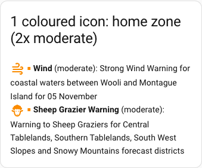 | 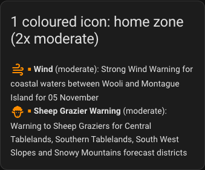 |
| Same, one severe warning | 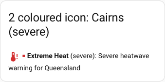 | 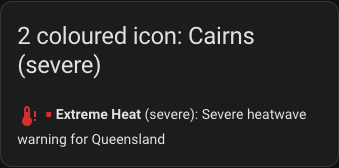 |
| Same, no warnings | 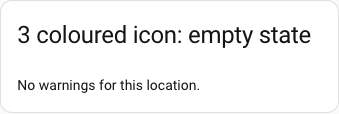 | 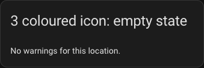 |
| Markdown card, emoji squares | 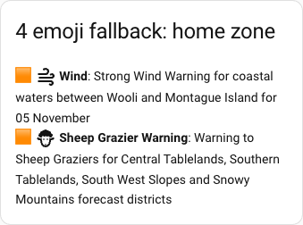 | 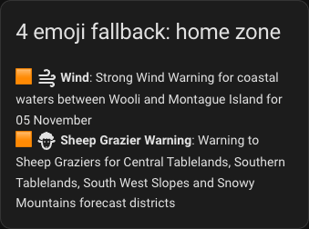 |
| Fire danger, coloured icon (High is yellow) | 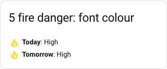 | 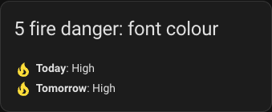 |
| Fire danger, emoji squares | 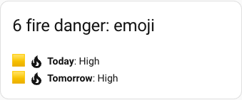 | 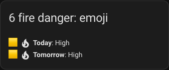 |
